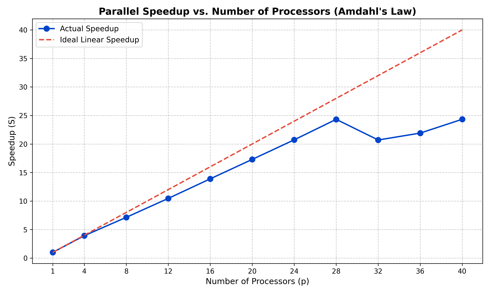

# Parallel Monte Carlo Integration & Amdahl's Law Analysis

This repository contains an MPI (Message Passing Interface) C++ implementation of Monte Carlo integration designed to evaluate the Gamma function[cite: 5, 13]. The project utilizes a parallelized Linear Congruential Generator (LCG) via the "leapfrog" method to efficiently distribute random number generation across multiple processors[cite: 6, 8]. The primary objective is to benchmark the strong scaling performance of the application on a SLURM-managed HPC cluster and validate the theoretical limits defined by Amdahl's Law[cite: 6, 13].

## Files in this Repository
- `main_openmp.cpp`: The core C++ MPI source code implementing the leapfrog random number generator and Monte Carlo integration.
- `job_openmp.sh`: The SLURM batch execution script used to test scaling from 1 to 40 processors.
- `amdahlslaw_graph.py`: A Python visualization script that processes execution times to map speedup efficiency.
- `updated_amdahls_law_graph.png`: The generated data visualization demonstrating Amdahl's Law.

## Mathematical Background & Methodology
The program estimates the Gamma function for real positive values using the finite limits integral:
$$\Gamma(x)=\int_{0}^{1}(log\frac{1}{t})^{x-1}dt$$

To achieve this in parallel without massive network overhead, the algorithm avoids a traditional Master-Slave architecture[cite: 7]. Sending 3,000,000,000 seeds from a master node to slave nodes would require approximately 13,968 seconds just for network transmission. Instead, the program uses the leapfrog method, where a jump constant ($k$) allows each processor to independently generate its unique sequence of random numbers by leaping over values used by other processes[cite: 8]. 

Testing the implementation with 3,000,000,000 samples successfully estimated $\Gamma(5) = 24$ with a highly accurate output of 23.9986 across all thread counts, proving the validity of the parallelized sequence.

## Prerequisites
To compile and run this code, your environment requires:
- C++ Compiler (`g++`)
- MPI Library (OpenMPI)
- SLURM Workload Manager (for cluster execution)
- Python 3 & Matplotlib (for visualization)

## Compilation and Execution

To compile the C++ source code using the MPI wrapper:

```bash
mpic++ -O3 main_openmp.cpp -o main_openmp
```
To execute the strong scaling benchmark suite on a SLURM-managed HPC cluster:Bashsbatch job_openmp.sh
Note: The source code is compiled with the -O3 flag to maximize sequential execution efficiency before parallelization.   Performance Analysis & Data VisualizationThe experimental design evaluates strong scaling by maintaining a fixed computational workload of 3,000,000,000 samples while scaling the processor count. The Python script (plot_amdahls.py) graphs the resulting output to visualize the actual speedup versus ideal linear speedup.   Sample OutputThe execution times demonstrate Amdahl's Law perfectly. Scaling from 1 to 28 processors resulted in a highly efficient, near-linear speedup. However, as the processor count increased beyond 28, the sequential portions of the code—such as MPI environment initialization and the final reduction sum—created a bottleneck. Crossing the physical hardware boundary from intra-node shared memory to inter-node network communication introduced latency that outweighed the computational gains, causing the speedup to plateau and efficiency to drop significantly.   

## Sample Output



**Author**<br>
Subrota Debnath<br>
Master of Information Sciences<br>
Massey University
